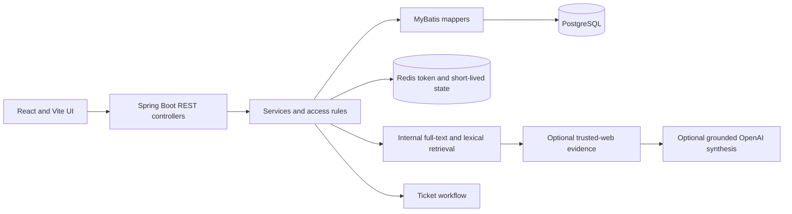

# CloudOps Knowledge Base & Ticket Assistant

## Project Overview

A full-stack CloudOps support application that combines ticket handling, an internal knowledge base, document-backed answers and optional LLM synthesis. It is a personal software project and is not presented as commercial production software.

## Problem and Motivation

Support teams need answers grounded in internal runbooks and a clear route to human help when the available evidence is insufficient. This application models that loop with searchable documents, source references, feedback and ticket creation.

## Key Features

- Ticket creation, assignment, resolution and closure workflows.
- Knowledge article and uploaded TXT/Markdown document management, chunking, search and archive operations.
- Internal-first lexical/full-text evidence retrieval; optional trusted-web evidence and optional OpenAI synthesis.
- Source references, answer feedback, knowledge-gap tracking and escalation to a ticket when unresolved.
- OAuth2/JWT authentication and role-aware administration when provider and backend configuration is available.

## Technology Stack

Java 17, Spring Boot 3.5.x, Spring Security, MyBatis, PostgreSQL, Redis, React 19, Vite, JavaScript/JSX, Docker Compose and Maven. The repository includes a Flyway dependency, but current database bootstrap behavior is based on versioned SQL scripts; runtime migration execution was not verified.

## System Architecture



The answer path searches internal sources before optional external evidence and LLM synthesis. Vector embeddings and vector reranking are not implemented.

## Installation and Quick Start

Prerequisites: JDK 17, Docker Desktop/Engine, Node.js and npm. Docker Compose provides the local PostgreSQL and Redis services. Create `.env` from `.env.example`, set a private JWT secret, and add OAuth/provider credentials only when using those integrations. Never commit `.env` or provider secrets.

```powershell
copy .env.example .env
docker compose up -d
```

Initialize a new database by applying the SQL scripts in `ai-support-server/src/main/resources/db/manual` in numeric order. For an existing database, apply only migrations that have not already run; do not replay scripts blindly. Product knowledge samples are under `ai-support-server/src/main/resources/knowledge-seed/cloudops`.

Start the backend from `ai-support-server` after configuring `.env`:

```powershell
cd ai-support-server
.\mvnw.cmd spring-boot:run
```

In a separate terminal, start the frontend:

```powershell
cd ai-support-web
npm ci
npm run dev
```

OAuth, provider-backed LLM answers and external-web retrieval require their corresponding local credentials and services. Frontend build verification: `npm run build` from `ai-support-web`.

## Technical Challenges and Solutions

- Enforced authenticated/role-aware access through Spring Security and JWT while retaining OAuth sign-in options.
- Split business logic into controller/service/mapper layers with PostgreSQL persistence and Redis-backed token state.
- Kept answer generation evidence-first and traceable; unresolved requests can enter the ticket workflow.
- Used lexical/full-text coverage rather than claiming vector semantic retrieval.

## Build Verification

Package the backend from `ai-support-server`:

```powershell
.\mvnw.cmd -DskipTests package
```

Build the frontend from `ai-support-web` with `npm ci` followed by `npm run build`. Provider integrations require local credentials and have not been represented as production-verified here.

## Current Limitations

- No vector embeddings or reranker; lexical retrieval may miss semantically related wording.
- Provider-backed flows require secrets and were not verified end to end. SQL scripts are present, but this audit did not establish a fresh production migration/bootstrap path.
- The real UI has not yet been captured in a configured environment; no mockup is used as feature evidence.

## Roadmap

- Add a sanitized, authentic screenshot set from a configured isolated environment.
- Document one clean database bootstrap path and the exact environment variables.
- Add browser-level workflow verification for sign-in, knowledge search, answer citations and ticket escalation.
- Revisit retrieval evaluation and describe measured behavior only when a reproducible evaluation set exists.
