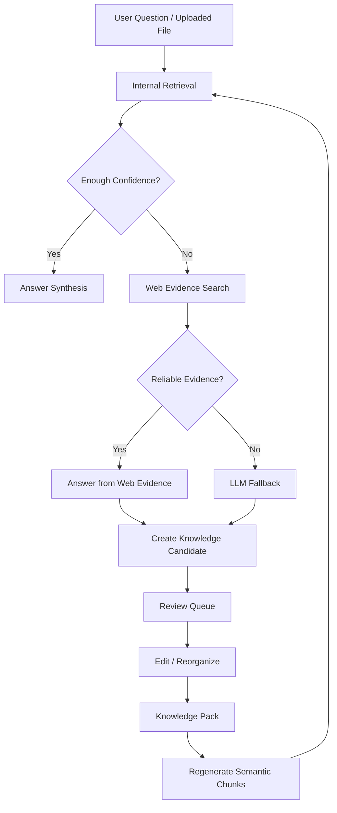

# AegisCloud AI Knowledge Base Optimization Plan

This document records the staged optimization plan for the AI Knowledge Base / RAG platform.

The system goal is to maintain enterprise-grade Knowledge Packs, semantic chunks, Web Evidence, Review Queue, Knowledge Gaps, and AI Answers with long-term maintainability, low redundancy, clear review lifecycle, and stable knowledge evolution.

## 1. Current System Problems

The current system already has the right direction: Knowledge Packs, uploaded documents, document chunks, Web Evidence, Review Candidates, AI logs, tickets, and administrator pages. The main problem is that the operational lifecycle is still incomplete.

Core issues:

- Several admin APIs return full lists instead of paginated, filterable result sets.
- Web Evidence and Review Candidates can be rejected, but old rejected records do not have a cleanup/archive/delete lifecycle.
- Knowledge Gaps are derived from AI question logs instead of being managed as first-class review tasks.
- Chunks are still attached to documents only and do not yet have independent governance.
- Article management supports edit and archive, but does not yet support structured reorganization, merge, section movement, or chunk regeneration as a complete workflow.
- Review flows need stronger edit-before-approve behavior.
- AI Answers need a stronger retrieval evaluation step so weak internal matches do not block Web or LLM fallback.

## 2. Severity-Ordered Problem List

### P0 - Blocking Product Quality

- Admin lists can grow without backend pagination.
- Rejected Web Evidence and Review Candidates remain visible without archive/delete cleanup.
- Gap page lacks lifecycle controls: no delete, archive, search, status filter, or action conversion.
- Review flows lack a complete edit-before-approve API surface.
- Category/domain mismatch must remain a hard stop before Knowledge Pack reorganization.

### P1 - Knowledge Quality

- Existing articles may contain stitched content, process labels, Title/Purpose remnants, or low-density generated text.
- Chunks need independent management: edit, delete, regenerate, filter, search, pagination.
- Review Queue should distinguish raw evidence, extracted knowledge insight, and reorganization plan.
- Article updates should reorganize knowledge, not merge source documents.

### P2 - Advanced AI / RAG

- Retrieval results need explicit confidence evaluation before answer generation.
- Web and LLM fallback should create reviewable knowledge candidates without polluting trusted articles.
- Audit logs and lifecycle history should be added for enterprise traceability.

## 3. Recommended System Flow

## 4. Module-Level Changes

### Article Management

Add or improve:

- Search, category filter, status filter, backend pagination.
- Edit, archive, delete/soft-delete where appropriate.
- Reorganize article.
- Merge duplicate articles.
- Move section.
- Regenerate article chunks.
- Detect low-quality article content.
- Detect process artifacts such as Title, Purpose, Runbook, SOP, Knowledge Candidate, raw source metadata.

### Chunk Management

Add:

- Dedicated chunk management page.
- Search and pagination.
- Filter by source type, article, document, category, and status.
- Edit chunk.
- Delete/archive chunk.
- Regenerate chunks from Knowledge Pack.
- Show chunk source, section title, semantic key, and status.

### Review Queue

Add:

- Pending / Approved / Rejected / Archived states.
- Edit before approve.
- Delete old rejected records.
- Archive old records.
- Batch reject, archive, delete.
- Status and category filters.
- Domain enforcement before approval.

### Web Evidence

Add:

- Delete and archive.
- Cleanup of rejected records.
- Status, origin, category, and keyword filters.
- Edit suggested internal article before approval.
- Distinguish `WEB_SEARCH` and `LLM_GENERATED` origins.
- Separate raw evidence from knowledge insight and reorganization plan.

### Knowledge Gaps

Redefine Gap as a managed task:

- Knowledge Gap
- Missing Knowledge
- Failed Answer
- Needs Evidence
- Bad Internal Match

Add:

- Pagination.
- Search.
- Status filter.
- Priority filter.
- Delete/archive.
- Create Web Search task.
- Create Knowledge Candidate.
- Create Ticket.
- Link to AI log, evidence, candidate, and article.

### Frontend Experience

Each admin list page should include:

- Search.
- Status filter.
- Category filter.
- Sorting.
- Backend pagination.
- Batch operation toolbar.
- Detail drawer.
- Edit modal.
- Empty state.
- Loading state.
- Error state.
- Clear status tags.

## 5. Data Table Suggestions

### Common Lifecycle Columns

For long-lived admin records, add:

- `status`
- `deleted_at`
- `archived_at`
- `archived_by`
- `reviewed_by`
- `reviewed_time`
- `review_note`
- `quality_score`
- `created_time`
- `updated_time`

### Web Evidence

Recommended additions:

- `deleted_at`
- `archived_at`
- `archived_by`
- `review_note`
- `knowledge_insight`
- `reorganization_plan`
- `quality_score`

### Document Knowledge Candidates

Recommended additions:

- `deleted_at`
- `archived_at`
- `archived_by`
- `review_note`
- `target_section`
- `knowledge_insight`
- `reorganization_plan`

### Knowledge Gaps

Recommended new first-class table:

- `id`
- `question`
- `failed_answer`
- `source_log_id`
- `category`
- `gap_type`
- `status`
- `frequency`
- `priority`
- `created_ticket_id`
- `web_evidence_id`
- `candidate_id`
- `resolved_article_id`
- `created_by`
- `resolved_by`
- `created_time`
- `resolved_time`
- `deleted_at`

### Chunks

Recommended additions:

- `source_type`
- `source_article_id`
- `source_document_id`
- `section_title`
- `semantic_key`
- `chunk_status`
- `quality_score`
- `deleted_at`

## 6. Backend API Suggestions

### Web Evidence

- `GET /api/admin/web-evidence?page=&size=&status=&origin=&category=&keyword=`
- `PUT /api/admin/web-evidence/{id}/suggested-article`
- `PATCH /api/admin/web-evidence/{id}/reject`
- `PATCH /api/admin/web-evidence/{id}/archive`
- `DELETE /api/admin/web-evidence/{id}`
- `POST /api/admin/web-evidence/bulk/archive`
- `POST /api/admin/web-evidence/bulk/delete`

### Review Candidates

- `GET /api/admin/document-knowledge-candidates?page=&size=&status=&category=&keyword=`
- `PUT /api/admin/document-knowledge-candidates/{id}`
- `POST /api/admin/document-knowledge-candidates/{id}/approve`
- `PATCH /api/admin/document-knowledge-candidates/{id}/reject`
- `PATCH /api/admin/document-knowledge-candidates/{id}/archive`
- `DELETE /api/admin/document-knowledge-candidates/{id}`

### Knowledge Gaps

- `GET /api/admin/knowledge-gaps?page=&size=&status=&category=&keyword=`
- `GET /api/admin/knowledge-gaps/{id}`
- `PATCH /api/admin/knowledge-gaps/{id}/archive`
- `DELETE /api/admin/knowledge-gaps/{id}`
- `POST /api/admin/knowledge-gaps/{id}/web-search`
- `POST /api/admin/knowledge-gaps/{id}/candidate`
- `POST /api/admin/knowledge-gaps/{id}/ticket`

### Chunks

- `GET /api/admin/chunks?page=&size=&sourceType=&articleId=&documentId=&keyword=`
- `PUT /api/admin/chunks/{id}`
- `DELETE /api/admin/chunks/{id}`
- `POST /api/admin/articles/{id}/chunks/regenerate`

## 7. AI Prompt / Agent Flow

Do not use one universal prompt for every knowledge task.

Use staged prompts or service components:

1. Retrieval Evaluator
   - Decide whether internal evidence truly answers the user question.
2. Evidence Cleaner
   - Remove navigation, page noise, source labels, and marketing copy.
3. Answer Synthesizer
   - Answer the user directly and concisely.
4. Knowledge Candidate Builder
   - Convert useful external or model knowledge into reviewable insight.
5. Article Reorganizer
   - Rewrite the affected Knowledge Pack section.
6. Chunk Regenerator
   - Rebuild semantic chunks after article changes.

## 8. Priority Development Plan

### P0

- Backend pagination/filtering for Web Evidence, Review Candidates, AI Logs, Tickets, Gaps.
- Archive/delete cleanup for rejected Web Evidence and Review Candidates.
- Edit-before-approve endpoint for Web Evidence and Review Candidates.
- Gap page lifecycle controls.
- Frontend status filters, search, pagination, and action buttons.

### P1

- Dedicated Chunk Management page.
- Article reorganization tools.
- Duplicate/low-quality article detection.
- Regenerate chunks from article.
- Review Queue unified across Web, LLM, Document, Gap.

### P2

- First-class `knowledge_gaps` table.
- Audit logs.
- Retrieval confidence evaluator.
- Higher-quality AI synthesis with model gateway.
- Batch governance tools.

## 9. Final Target Architecture

The target architecture is not a simple article manager.

It should be:

- Knowledge Pack: trusted durable knowledge.
- Semantic Chunk: retrieval unit.
- Evidence: raw external/model/document signal.
- Knowledge Candidate: reviewed intake object.
- Gap: missing-knowledge work item.
- Review Task: approval workflow.
- Audit Log: traceability.
- AI Answer: concise response layer that never directly pollutes trusted knowledge.

The system should continuously improve by turning missed questions, external evidence, uploaded files, and model answers into reviewed, reorganized Knowledge Packs and regenerated semantic chunks.
